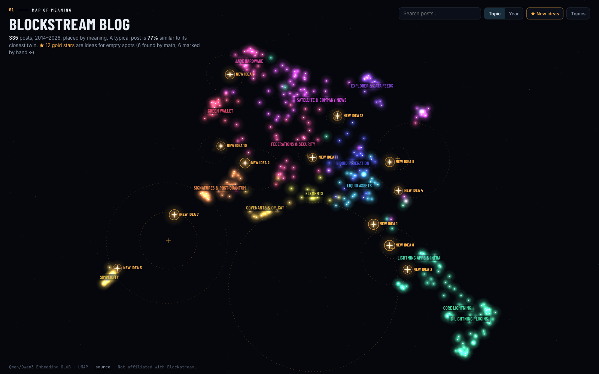

# Blockstream Blog Map

An interactive map of every post on [blog.blockstream.com](https://blog.blockstream.com/), placed by meaning, plus generated "new idea" posts for the empty spots between topics, some found by math and some marked by hand.

**Live map:** https://brenorb.com/blockstream-blog-map/



Inspired by [this video](https://x.com/re_skob/status/2113043120128483349), which did the same thing for every game on Steam.

## How it works

1. **Scrape** – `scripts/scrape.py` reads the blog's public sitemap and pulls each post's title, description, tags, authors, dates and opening text.
2. **Embed** – `scripts/embed.py` turns each post into 1024 numbers with the open-weights model [Qwen3-Embedding-0.6B](https://huggingface.co/Qwen/Qwen3-Embedding-0.6B) (Apache-2.0). The embedded text is the title, description, tags and the first 200 words.
3. **Map** – `scripts/build_map.py` groups posts into 14 topics (k-means), lays them out in 2D with UMAP (cosine), and records each post's nearest neighbors and how lonely it is.
4. **Site** – `docs/` is a static page (canvas + d3-zoom) served by GitHub Pages.
5. **Find holes** – `scripts/find_gaps.py`. Holes were first spotted by eye in a screenshot of the live map ([`analysis/map-before.png`](analysis/map-before.png)), then snapped to empty circles of the Delaunay triangulation of the 2D layout. Every hole is ranked by size and by how related the posts on its rim are ([`analysis/holes.png`](analysis/holes.png)).
6. **Pick a point in embedding space** – for each hole, the posts on its rim are averaged (the "blend"). The blend is then pushed away from all 335 posts by gradient ascent on the unit sphere: minimize a smooth max of cosine similarity to every post, while staying within cosine 0.86 of the blend so the point stays specific instead of drifting into generic mush. This lowers the nearest-post similarity from 0.82–0.90 to 0.67–0.76.
7. **Turn the point back into a post** – `scripts/ghosts.py`. Each target is "read" through its nearest posts and the tags it leans toward. Candidate posts are written for it (`data/ghost_drafts.json`), and each candidate is embedded exactly like a real post. A candidate is kept only if it lands inside its hole on the 2D map and is further from every real post than a typical post is from its own twin (0.775). Weak holes got a second round of drafts. The best candidate per hole is drawn on the map as a gold star.

## The generated ideas

Twenty-four candidate posts were tried for six holes; all scores are in `data/ghost_attempts.json`. These six were kept:

| # | Idea | Hole | Cos to target | Closest real post (sim) | Real posts with a closer twin |
|---|---|---|---|---|---|
| 1 | [Smart Contracts as Lightning Endpoints: Paying Liquid Contracts over Lightning](https://brenorb.com/blockstream-blog-map/#idea-1) | Void below Covenants & Elements | 0.66 | Enabling Lightning Payments with Liquid Swaps in the Blockstream App (0.70) | 74% |
| 2 | [Hiding the Policy and the Amount: Designing a Fully Private Taproot Wallet](https://brenorb.com/blockstream-blog-map/#idea-2) | Pocket between Green, Signatures & Federations | 0.67 | PSET: Constructing Confidential Transactions (0.67) | 86% |
| 3 | [Lightning for Shops Without Running a Node](https://brenorb.com/blockstream-blog-map/#idea-3) | Strip between Liquid Assets & Lightning | 0.64 | Enabling Lightning Payments with Liquid Swaps in the Blockstream App (0.72) | 68% |
| 4 | [An Interop Scorecard for Bitcoin Layers](https://brenorb.com/blockstream-blog-map/#idea-4) | Gap between Explorer, Liquid & the data-feed island | 0.54 | Increasing Interoperability Between Bitcoin’s Second-Layer Protocols (0.66) | 87% |
| 5 | [Clear Signing for Simplicity: Teaching a Hardware Wallet to Read Contracts](https://brenorb.com/blockstream-blog-map/#idea-5) | Edge between Simplicity & Signatures | 0.63 | Welcome to the New Simplicity \| Blockstream (0.73) | 64% |
| 6 | [A Self-Custody Workshop in a Box](https://brenorb.com/blockstream-blog-map/#idea-6) | Gap between Jade & Green Wallet | 0.64 | Blockstream Local: Now Powered by the Blockstream App (0.69) | 80% |

"Cos to target" is how close the written post's embedding is to the chosen point. For comparison, the posts the point was blended from sit at about 0.6–0.7 from it.

## Spots marked by hand

After the first version went live, six more spots were circled by hand on a screenshot of the map ([`analysis/marks-by-hand.png`](analysis/marks-by-hand.png)). The gold stars in that same screenshot have known map positions, so a straight-line fit converts the marks to map coordinates, accurate to about one pixel (`data/user_marks.json`).

This round aims at the exact point instead of a whole hole. `scripts/marked.py` embeds each draft (`data/marked_drafts.json`), places it on the map and reports how far it lands from the mark and which real posts pull it which way. Drafts were rewritten in rounds until one landed within half the distance from the mark to its nearest real post (at least 0.04 map units), without being closer to a real post than a typical post is to its twin. It took 49 drafts over five rounds; the last round added one or two sentences to the best draft to nudge it toward the side it was missing. On the map, a ✛ marks each spot and the dashed circle is the allowed landing zone.

| # | Idea | Spot | Lands off / allowed | Closest real post (sim) | Real posts with a closer twin |
|---|---|---|---|---|---|
| 7 | [Writing a Quantum-Safe Spending Path in Simplicity](https://brenorb.com/blockstream-blog-map/#idea-7) | 1 | 0.118 / 0.128 | Blockstream Research Demonstrates Quantum-Resistant Transaction Signing on Liquid Using Simplicity Smart Contracts (0.77) | 52% |
| 8 | [Swaps as a Service: A Core Lightning Plugin for Lightning–Liquid Swaps](https://brenorb.com/blockstream-blog-map/#idea-8) | 2 | 0.020 / 0.045 | Announcing Blockstream Swaps (0.72) | 72% |
| 9 | [A Price Oracle for Liquid, Built from the Crypto Data Feed](https://brenorb.com/blockstream-blog-map/#idea-9) | 3 | 0.039 / 0.051 | The Blockstream App Now Displays Live Prices for Liquid Assets (0.61) | 93% |
| 10 | [Two Keys, One Phone, No Surprises: Safer Multisig with MuSig2 and Hardware Wallets](https://brenorb.com/blockstream-blog-map/#idea-10) | 4 | 0.040 / 0.059 | MuSig2: Simple Two-Round Schnorr Multisignatures (0.70) | 74% |
| 11 | [Proving the Supply of a Federation: Audits for E-Cash and Sidechains](https://brenorb.com/blockstream-blog-map/#idea-11) | 5 | 0.024 / 0.040 | What the Zcash Orchard Bug Reveals About Verifiable Supply (0.69) | 79% |
| 12 | [Check, Don't Trust: Reserves, Messages and Software](https://brenorb.com/blockstream-blog-map/#idea-12) | 6 | 0.016 / 0.040 | Standardizing Bitcoin Proof of Reserves (0.69) | 79% |

Spot 1 is a true void. Even unrestricted mixes of real posts' embeddings land no closer than 0.14 to it, because UMAP places a new point next to its nearest neighbors, and every neighbor sits on one side of the void or the other. The best draft lands 0.12 above the mark, still in the empty area, but it is the weakest idea: its closest real post already demonstrates quantum-resistant signing with Simplicity on Liquid, so it adds a tutorial angle rather than a new topic.

The first round's ideas only had to land within 1.25× their hole's radius, so several of them sit on the rim of their hole rather than inside it.

## Run it

```bash
uv sync
cd scripts
uv run python scrape.py
uv run python embed.py
uv run python build_map.py   # map without ideas
uv run python find_gaps.py   # holes + target points
uv run python ghosts.py      # score drafts in data/ghost_drafts.json
uv run python marked.py      # score drafts for hand-marked spots (data/marked_drafts.json)
uv run python build_map.py   # map with ideas
python3 -m http.server -d ../docs 8765
```

## Notes

- Only titles, descriptions and metadata are published in `docs/data.json`. Post bodies stay in the git-ignored `data/raw/`.
- One post on the blog, `/reducing-bitcoin-transaction-sizes-with-x-only-pubkeys-2/`, has the c-lightning 0.7.3 text under the x-only pubkeys title. It's kept as published.
- The generated ideas are not Blockstream posts and make no claims about Blockstream's plans.
- Not affiliated with Blockstream.
